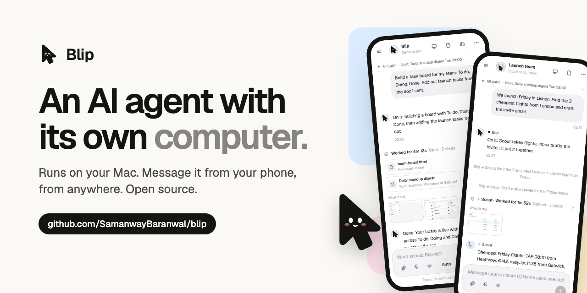
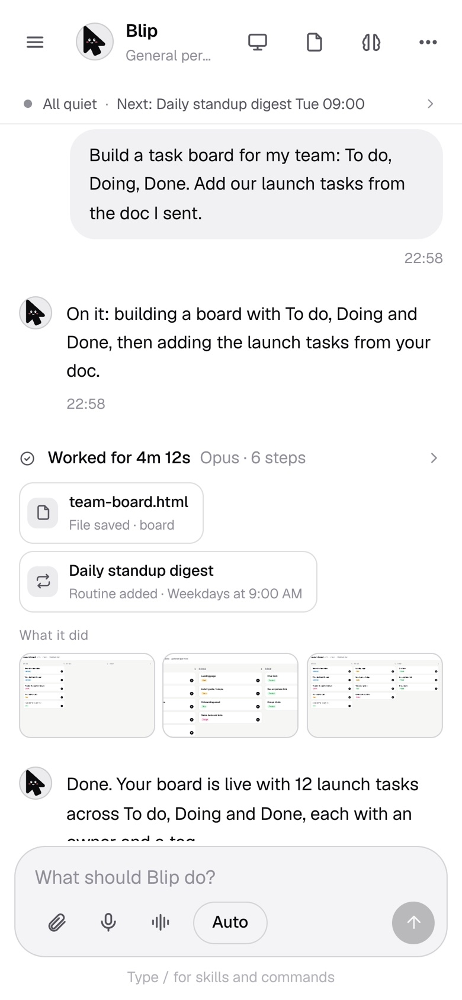
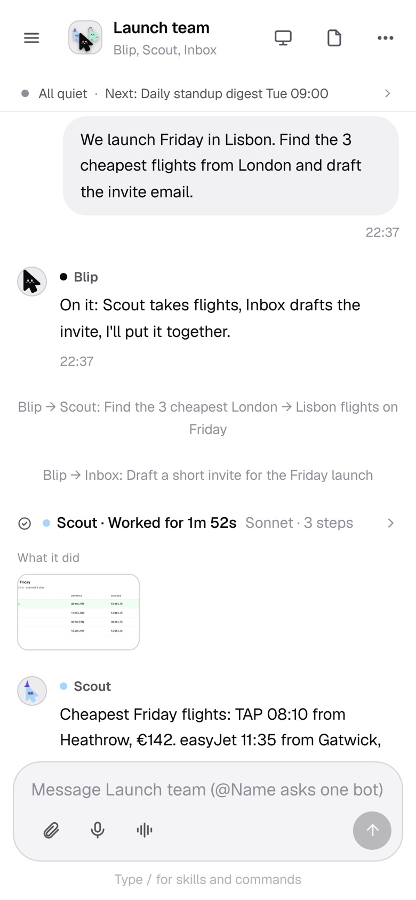
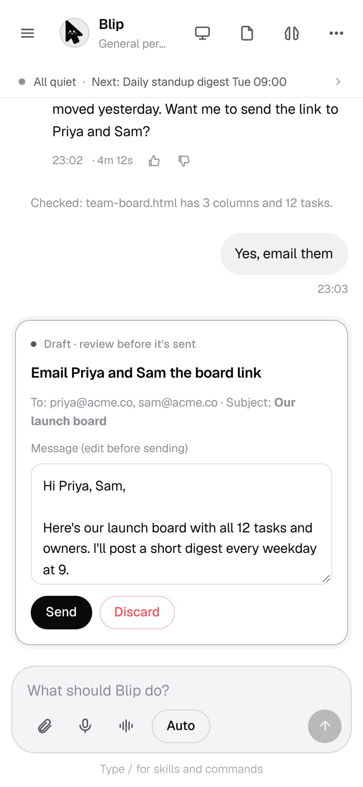
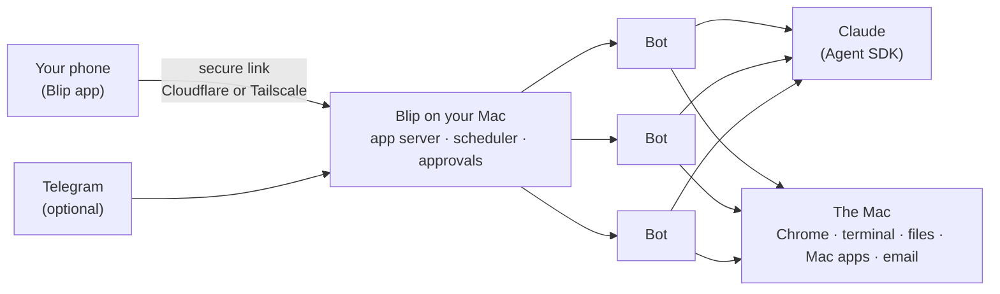

<div align="center">

<a href="https://blip-jade.vercel.app"></a>

# Blip

**An AI agent with its own computer.**<br />
It lives on your Mac and does the real work. You message it from your phone, from anywhere.

[](LICENSE)
[](#make-your-blip-ready)
[](https://docs.claude.com/en/docs/agent-sdk/overview)
[](#make-your-blip-ready)
[](CONTRIBUTING.md)

[Website](https://blip-jade.vercel.app) · [Install](#make-your-blip-ready) · [Features](#features) · [How it works](#how-it-works) · [Full guide](docs/GUIDE.md)

</div>

---

## Make your Blip ready

Ten steps, about 15 minutes, done **once**. You give Blip everything it needs from your Mac at the start, so it never has to stop and ask the Mac for a permission later.

**Before you install (5 minutes)**

1. **Get a Mac that stays on.** A Mac mini or an old MacBook, plugged in.
2. **Install the basics:** [Google Chrome](https://www.google.com/chrome/), [Homebrew](https://brew.sh), and Apple's developer tools (`xcode-select --install`).
3. **Run the install line.** It installs everything else (Node.js, ffmpeg, speech-to-text, the Cloudflare tunnel), starts Blip in `~/Blip`, and starts the walkthrough for steps 4 to 10.

   ```bash
   curl -fsSL https://raw.githubusercontent.com/SamanwayBaranwal/blip/main/install.sh | zsh
   ```

**The walkthrough (10 minutes, in the same Terminal window)**

4. **Connect Claude.** Sign in to [Claude Code](https://claude.com/claude-code) once (the walkthrough installs it if needed), or add an Anthropic API key in the app.
5. **Keep the Mac awake.** One yes, and your Mac password: the Mac never sleeps while plugged in, and it starts again by itself after a power cut.
6. **Allow Calendar, Reminders, Contacts and Mail.** A few **Allow** popups appear at once: click Allow on each. Mail opens once so it can be allowed too.
7. **Allow the screen and the mouse.** Two System Settings panes open. Turn on **node** in **Screen & System Audio Recording** and in **Accessibility**. Blip restarts and checks every permission, with a fix for anything that's missing.
8. **Sign in to your sites.** A Chrome window opens with Blip's own browser. Sign in once to what your bots will use (Gmail, Google Calendar, X, your work tools), so they never hit a login page later. If you use your own Chrome through the Playwright Extension instead, install the extension now.
9. **Put Blip on your phone.** Choose your link: Cloudflare (no account) or Tailscale (a link that never changes). Scan the QR code, add Blip to your Home Screen (iPhone: *Share → Add to Home Screen*), open it, and allow notifications.
10. **Choose full access.** Your bots then work without approval cards. Payments, protected files and your own "Ask first" rules still ask: that's the safety net.

That's it. Run `~/Blip/blip.sh ready` again any time to re-check everything (finished steps are skipped), and run the install line again to update Blip. Every detail is in [Set up on a new Mac](docs/GUIDE.md#set-up-on-a-new-mac). Optional extras in the app: give Blip [its own email](docs/GUIDE.md), and add your email in **Set up** so a new Cloudflare link always reaches you.

## Why Blip

> "I didn't open my laptop for 10 days. Blip did my work."

For ten days I ran my work through Blip from my phone. One prompt at a time, it built a ClickUp-style project platform for my company and set up many of my day-to-day automations, while the Mac sat at home doing the work.

Blip gives an AI a real computer: a terminal, files, a real Chrome browser and your Mac's own apps. It tells you what it's about to do, does it, and shows you the proof. Anything that sends, pays or deletes waits for your OK.

**Got a Mac mini sitting there?** Maybe you bought it for OpenClaw. Blip runs on the same machine, installs in one line, and turns it into an agent you use every day from your phone.

## See it

<table>
  <tr>
    <td width="33%"></td>
    <td width="33%"></td>
    <td width="33%"></td>
  </tr>
  <tr>
    <td align="center"><b>Replies first, then works</b><br /><sub>Steps, files and screenshots as proof</sub></td>
    <td align="center"><b>A team of bots</b><br /><sub>The lead splits the job; they work at once</sub></td>
    <td align="center"><b>Nothing goes out without you</b><br /><sub>Drafts you edit, then approve</sub></td>
  </tr>
</table>

## Features

| | |
|---|---|
| **Talks while it works** | Replies "On it" in seconds, then works. Send three messages and each gets its own answer, in order. |
| **Real computer** | Terminal, files, a real Chrome browser with your logins, and Mac apps: Calendar, Reminders, Contacts, Mail, Spotlight. |
| **Group chats** | Put several bots in one chat. The lead hands parts to the others, and they work in parallel. `@Name` asks one directly. |
| **Proof of work** | Screenshots of what it did, a replay of its browser session, the files it made, and an independent double-check. |
| **You stay in control** | Approval cards for anything risky, editable drafts, Auto Review, "Ask first" rules, and Allow / Deny right on the notification. |
| **Remote control** | See and use the Mac's screen from your phone, like Chrome Remote Desktop. |
| **Routines and triggers** | "Every weekday at 9, brief me on my inbox." Or start a routine from an email, a new file or a link. |
| **Use it anywhere** | One tap sets up a secure link from any network or country. Nothing to install on the phone. |
| **Voice** | Hands-free talk mode, voice messages and spoken replies. Speech-to-text runs on the Mac. |
| **Memory and skills** | It remembers what you told it, searches every past chat, and learns skills, including by watching you do a task once. |
| **Its own email** | Give it a mailbox. People can email your bot; every reply is a draft you approve. |
| **Privacy** | Lock chats with a passcode or Face ID. Passwords live in the Mac's Keychain; bots only see placeholders. |
| **Phone app** | Installs on your iPhone or Android Home Screen from the browser, with notifications. There's a Mac app too. |

Every feature is described in detail in the [full guide](docs/GUIDE.md).

## How it works



- Each bot is a [Claude Agent SDK](https://docs.claude.com/en/docs/agent-sdk/overview) agent with Blip's own tools, a real Chrome browser (Playwright) and any connectors you add.
- Bots work in parallel. They take turns only on the shared screen and browser.
- Everything (chats, memory, files, settings) stays on your Mac. There is no Blip server.
- Built with TypeScript and Node.js, with a [Preact](https://preactjs.com) app and a small Swift helper for the Mac. See [How it's built](docs/GUIDE.md#how-its-built).

## Safety

- **Asks before it acts.** By default, sending, paying, deleting, booking and accepting come to you as a card first. With full access on, only payments, protected files and your "Ask first" rules still ask.
- **A second pair of eyes.** An independent reviewer checks risky actions, and a double-check confirms the work really happened.
- **Your secrets stay secret.** Passwords go into the Mac's Keychain; bots only ever see a placeholder, and tool output is scrubbed.
- **Your data stays home.** Chats, memory and files live on your Mac. Only your requests go to the AI model.

More in [Security notes](docs/GUIDE.md#security-notes).

## FAQ

**Is it free?** Yes: open source under MIT. It runs on your Claude plan, or on an API key with a daily spending limit.

**Which Mac?** Any Mac that can stay on, Apple Silicon or Intel. A Mac mini is ideal.

**Already running another agent on that Mac mini?** Blip installs into its own folder (`~/Blip`) as its own background service, so you can try it alongside.

**Do I need the App Store?** No. The phone app installs from the browser.

## Contributing

Ideas, skills, tools and fixes are welcome. Read [CONTRIBUTING.md](CONTRIBUTING.md), then open an issue or a pull request. Run `npm test` (unit tests) and `npm run test:golden` (end-to-end, on a throwaway server) before sending a change.

## License

[MIT](LICENSE) © 2026 Samanway Baranwal
